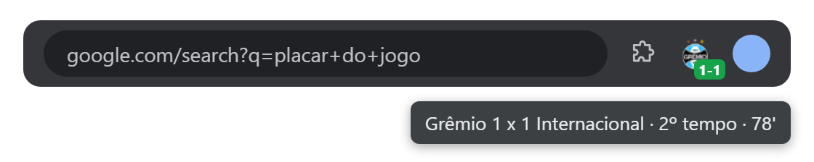
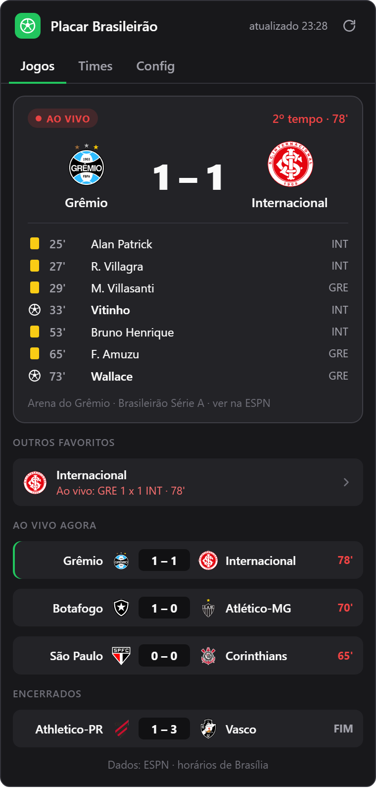

  

<h1 align="center">Placar Brasileirão</h1>

  O placar do Brasileirão ao vivo no ícone do Chrome, 
  com aviso de gol dos seus times.

  
  
  
  

  

  

---

<table>
  <tr>
    <td width="330" valign="top">
      
    </td>
    <td valign="top">
      <h3>O que ela faz</h3>
      
⚽ <b>Placar no ícone</b> O escudo do seu time e o placar em tempo real na barra do Chrome.

      
🔔 <b>Aviso de gol</b> Notificação do Windows a cada gol, no início, no intervalo e no fim do jogo.

      
⭐ <b>Vários times</b> Marque quantos quiser. O ícone mostra o primeiro que estiver jogando.

      
📅 <b>Próximo jogo</b> Sem jogo, o ícone mostra quando é o próximo: hora, dia ou dias que faltam.

      
📋 <b>Rodada inteira</b> No popup: lances do seu jogo, outros favoritos e todos os jogos do dia.

      
🔒 <b>Sem cadastro</b> Sem conta e sem login. Nada sai do seu navegador.

    </td>
  </tr>
</table>

## Instalar

> Ainda não está na Chrome Web Store. A instalação é manual e leva um minuto.

1. Baixe o `.zip` da **[versão mais recente](https://github.com/aliansantos/placar-brasileirao/releases/latest)** e extraia numa pasta que vai continuar existindo. O Chrome carrega a extensão dessa pasta.
2. Abra `chrome://extensions` e ligue o **Modo do desenvolvedor**, no canto superior direito.
3. Clique em **Carregar sem compactação** e escolha a pasta extraída (a que tem o `manifest.json`).
4. Fixe o ícone: clique no quebra-cabeça 🧩 e no alfinete ao lado de **Placar Brasileirão**.
5. Clique no ícone, vá na aba **Times** e marque seus times com a estrela.

## O que o selo do ícone mostra

| Selo | Quando aparece |
|:---:|---|
|  | Seu time está jogando (placar mandante–visitante) |
|  | Por 60 segundos depois de um gol |
|  | Intervalo |
|  | Fim de jogo. O placar fica por 3 horas (dá para mudar em **Config**) |
|  | Tem jogo hoje, no horário mostrado |
|  | Próximo jogo nesta semana |
|  | Faltam 14 dias para o próximo jogo |
|  | Sem conexão há mais de 2 minutos |

Passe o mouse no ícone para ver o texto completo, como *"Grêmio 1 x 1 Internacional · 2º tempo · 78'"*.

## Perguntas frequentes

<b>De onde vêm os placares? Com que frequência atualiza?</b>

 
Da API pública da ESPN. Durante o jogo do seu time, a extensão atualiza a cada 30 segundos. Sem jogo, a cada 15 minutos. Com o popup aberto, a cada 30 segundos.

<b>Qual time aparece no ícone se eu tiver vários?</b>

 
O primeiro da sua lista (aba <b>Times</b>) que estiver jogando. Se nenhum estiver em campo, aparece o jogo que acabou de terminar e, depois, o próximo jogo mais cedo entre os seus times. As setas na aba <b>Times</b> mudam a ordem.

<b>Como atualizo para uma versão nova?</b>

 
Baixe o <code>.zip</code> novo, substitua os arquivos na mesma pasta e clique no ↻ da extensão em <code>chrome://extensions</code>. Seus times e configurações continuam salvos. O que mudou em cada versão está nas <a href="https://github.com/aliansantos/placar-brasileirao/releases">Releases</a>.

<b>Funciona em Edge, Brave ou Opera?</b>

 
Esses navegadores também aceitam <b>Carregar sem compactação</b>, então a instalação deve funcionar. Por enquanto, a extensão só foi testada no Chrome.

<b>Tem Série B ou Copa do Brasil?</b>

 
Por enquanto, só a Série A.

<b>Quais dados a extensão usa?</b>

 
Seus times e configurações ficam só no seu navegador. A extensão acessa apenas <code>site.api.espn.com</code> (placares) e <code>a.espncdn.com</code> (escudos), e não lê as páginas que você visita. Detalhes na <a href="PRIVACY.md">política de privacidade</a>.

## Erros e ideias

Abra uma **[issue](https://github.com/aliansantos/placar-brasileirao/issues)**. Se for um erro, diga a versão da extensão (aparece em `chrome://extensions`) e a do Chrome.

---

Projeto pessoal, sem ligação com a ESPN, a CBF ou os clubes. Os placares vêm de uma API pública da ESPN que não é documentada oficialmente e pode mudar sem aviso. Escudos e nomes pertencem aos respectivos clubes. 
<b>Licença:</b> o código está visível, mas todos os direitos são reservados ao autor. Você pode instalar e usar a extensão. Para copiar, modificar ou redistribuir o código, peça permissão.
